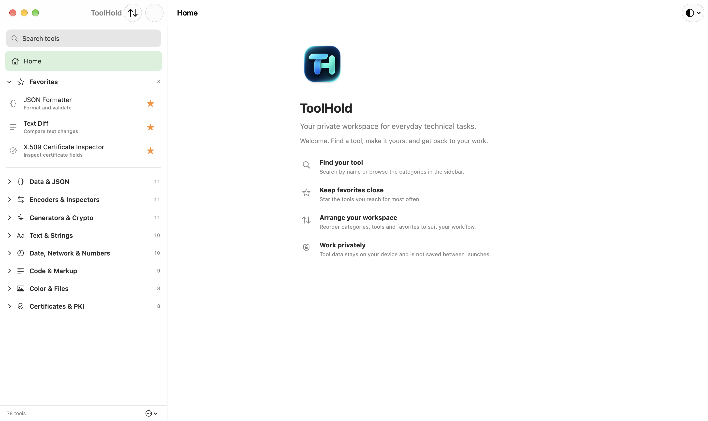
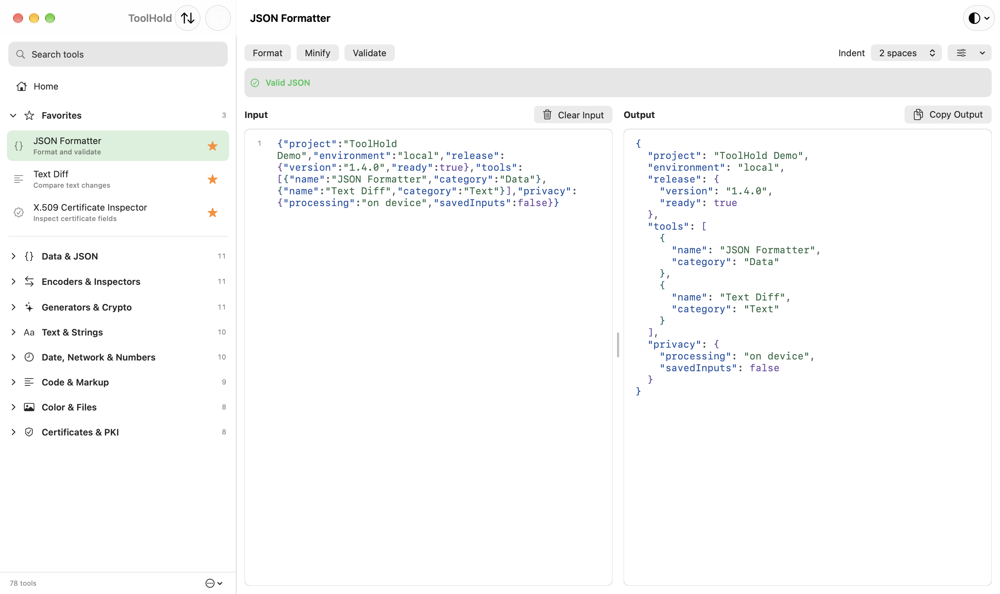
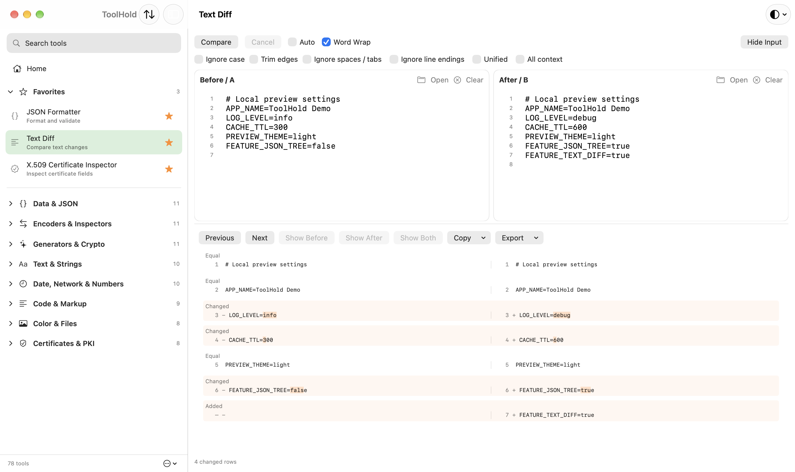
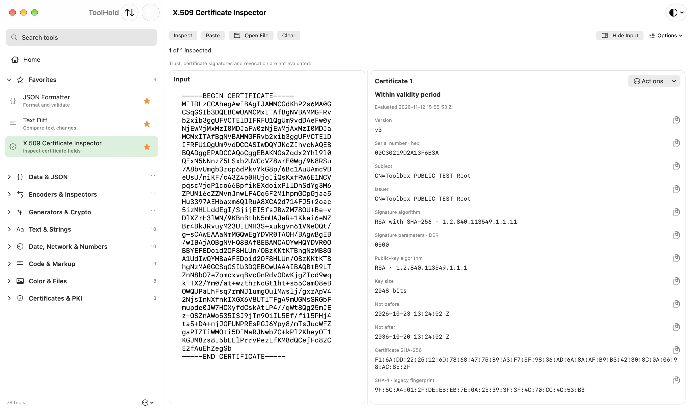

# ToolHold

**A native, local-first developer toolbox for macOS, built with Swift and SwiftUI.**

ToolHold brings recurring engineering tasks into one workspace: inspect and transform structured data, compare text, generate test values, work with certificates and keys, and more. Most processing happens entirely on-device; external preview resources can be loaded only with explicit permission.

The Xcode project also includes an iPhone and iPad target. The project was initiated and directed by Vitalii Kolosov, with substantial implementation developed using OpenAI Codex under his supervision.

## Screenshots

Real macOS app windows with synthetic examples. Click an image for full resolution; [capture details and example data](docs/screenshots/README.md).

| Home & navigation | JSON Formatter |
| --- | --- |
| [](docs/screenshots/home.png) | [](docs/screenshots/json-tool.png) |
| **Text Diff** | **Certificate Inspector** |
| [](docs/screenshots/text-tool.png) | [](docs/screenshots/pki-tool.png) |

## Features

- JSON formatting, validation, tree inspection, diff, JSONPath, JSON Schema and conversions to/from YAML, TOML, XML and CSV; model generation.
- Base64, URL/query, HTML entity, string escaping, HEX/UTF-8 and GZip tools.
- JWT inspection, encoding and signature verification; hashes, HMAC, identifiers, passwords and passphrases; QR code generation and decoding.
- Text comparison, regex, case and line transformations, Unicode inspection, mock data and text statistics.
- Dates, timestamps, cron, number conversions and offline network reference data.
- SQL, XML, YAML, HTML, CSS and JavaScript formatting, with static Markdown, HTML and MJML previews.
- Color and contrast calculations, local image processing, cURL-to-code and connection-string inspection.
- Certificate, CSR, key and PKCS#12 tools, including local generation, inspection and conversion.

The [tool catalog](docs/TOOL_CATALOG.md) documents all 78 available tools and their processing constraints. Checks before binary distribution are tracked separately in the [verification summary](PUBLIC_RELEASE_AUDIT.md#binary-distribution-gates).

## Requirements

- **macOS 27.0 or later** for the application, as configured in the Xcode project.
- **Xcode 27.x**, including its command-line tools and macOS SDK. This audit used Xcode 27.2 and Swift 6.4.2 on macOS 27.2.1, Apple Silicon. Earlier Xcode versions were not validated.
- SwiftPM manifests require Swift tools 6.0 or later. The core package's macOS 14/iOS 17 minimums do **not** lower the application's deployment target.
- The additional iPhone/iPad app target is configured for iOS/iPadOS 18.6 or later. Simulator/device coverage and remaining release checks are recorded in the audit.
- Python 3 is needed only for the optional verification scripts. Node/npm, Perl/make and language toolchains are needed only when regenerating specific vendored resources or running optional compiler harnesses.

## Building from Source

Clone the repository and open its Xcode project (which retains the original Developer Toolbox filename):

```sh
git clone https://github.com/ohrmann/ToolHold.git
cd ToolHold
open "Developer Toolbox.xcodeproj"
```

Select the shared **ToolHold Navigation** scheme and **My Mac** destination. All seven Swift package dependencies are vendored under `Vendor/`; Xcode resolves them locally. There are no submodules, required API keys, `.env` files, npm installations or package downloads for an ordinary app build. Checked-in JavaScript bundles and the OpenSSL XCFramework are intentional build inputs.

To build locally without an Apple Developer account or release-signing credentials:

```sh
xcodebuild \
  -project "Developer Toolbox.xcodeproj" \
  -scheme "ToolHold Navigation" \
  -configuration Debug \
  -destination 'platform=macOS' \
  -derivedDataPath .build/local-macos \
  CODE_SIGNING_ALLOWED=NO build
```

The output is `.build/local-macos/Build/Products/Debug/ToolHold.app`. The [macOS run helper](docs/IDE_RUN.md), `scripts/run-macos.sh`, builds an unsigned Debug app and runs its executable. Local IDE run configurations are not included.

Unsigned builds verify compilation and resource packaging. macOS may require a local signature to launch, and an unsigned run does not validate App Sandbox enforcement. For signed development runs, select your own team locally in Xcode, or supply signing settings on the command line. The checked-in team identifier is a public signing identifier, not a credential; its membership is not required for the unsigned command above. Release signing, notarization and Apple distribution account setup remain the owner's responsibility. Do not commit signing keys or provisioning profiles.

Optional, deliberate regeneration procedures are documented in [third-party notices](THIRD_PARTY_NOTICES.md), vendored component READMEs under `Vendor/`, [Code & Markup](scripts/code-markup/README.md) and [generated-model checks](Tests/GeneratedModels/README.md). They are separate from the normal build and can require additional tools or explicit downloads.

## Running Tests

Core tests use Swift Testing and XCTest through SwiftPM:

```sh
swift test --scratch-path .build/tests
```

This includes parsers, conversions, malformed-input/resource limits, secrets/preferences boundaries, cryptographic fixtures, file exports and native editor tests. It does not run the separate Xcode UI target. SwiftPM tests do not require real credentials or live APIs; committed keys/certificates are public synthetic fixtures and must never be used outside tests.

The Xcode UI target is `NavigationUITests`, under the shared scheme. On a development machine configured for GUI testing, run it from Xcode or use:

```sh
xcodebuild test \
  -project "Developer Toolbox.xcodeproj" \
  -scheme "ToolHold Navigation" \
  -destination 'platform=macOS' \
  -derivedDataPath .build/ui-tests \
  -only-testing:NavigationUITests
```

UI automation requires local signing/GUI permissions and is not part of the unsigned build guarantee. It uses a separate navigation preferences domain, but some scenarios use the system clipboard and Save dialogs: use disposable test destinations. See the audit for tests actually executed and scenarios still requiring manual checks.

Offline resource/license checks:

```sh
python3 scripts/code-markup/check.py
python3 scripts/check-network-references.py
python3 scripts/GenerateHTMLEntityTable.py --check
python3 scripts/check-third-party-notices.py
python3 scripts/verify-release-packaging.py .build/local-macos/Build/Products/Debug/ToolHold.app
python3 scripts/check-third-party-notices.py .build/local-macos/Build/Products/Debug/ToolHold.app
```

The audit records a fresh build from an isolated copy of publishable files with separate DerivedData/test output on the current computer. This is not verification on a clean machine, another OS, or Intel hardware. Restricted build environments may need explicitly writable compiler caches. SwiftPM tooling restrictions and the application's App Sandbox are separate concerns.

## Security & Privacy

Working inputs and outputs are held in memory; persisted preferences are limited to navigation and tool options. The app has no accounts, OAuth login, telemetry or cloud synchronization. It does not keep a credential vault or import generated keys into Keychain. There is no durable secret storage that requires a Keychain migration.

Processing is local. **One explicit exception:** HTML/Markdown/MJML previews can load external HTTPS images, stylesheets and fonts after selecting **Load external resources**. That permission is memory-only and revoked when input changes. Loading sends resource URLs and connection metadata to their hosts; URLs themselves can contain sensitive values. Scripts, frames and general navigation remain blocked. cURL-to-code generates code and does not send the request.

Copy and export are explicit operations. Clipboard managers, exported files, destination providers, native Undo and system staging can retain sensitive material. Clear/Hide is not a guarantee of secure memory or disk erasure. JWT decoding is not signature verification; certificate inspection is not proof of trust. Consult the tool's diagnostics and [recorded PKI limitations](PUBLIC_RELEASE_AUDIT.md#binary-distribution-gates) before using sensitive material.

See [SECURITY.md](SECURITY.md) for reporting guidance. Never attach working credentials, personal data or private keys to an issue or pull request.

## Contributing

Read [CONTRIBUTING.md](CONTRIBUTING.md) before opening an issue or pull request. Small, reproducible fixes with synthetic examples are welcome. The [documentation index](docs/README.md) covers the current architecture, development workflow and resource provenance. No response time or ongoing support commitment is promised.

## License

Vitalii Kolosov, acting as an individual, offers project code under the [PolyForm Perimeter License 1.0.1](LICENSE) to the extent he holds rights to license it, with the [required copyright notice](NOTICE). This is **source-available**, not OSI-approved open-source software. No exclusive copyright or enforceability is promised for every AI-generated fragment.

The license permits personal use, professional work, internal use in commercial companies, and studying/modifying the code for permitted purposes. It excludes using the licensed software to provide others a competing product, including a free competing product. It does not impose a blanket ban on commercial use or all resale; the full terms define competition and distribution obligations. [Official terms](https://polyformproject.org/licenses/perimeter/1.0.1).

Third-party code and data retain their [own licenses and notices](THIRD_PARTY_NOTICES.md). Names, logos, app icons and branding artwork have a [separate provenance record](ASSET_PROVENANCE.md) and [separate branding permission](BRANDING_TERMS.md), Version 1, approved by the owner and effective **2026-11-12**. For the listed artwork, it provides for technical forks, local/CI builds and permitted app redistribution without automatically requiring replacement names or icons. The owner has confirmed rights in this personal project and the absence of employer contractual restrictions; [the verification summary](PUBLIC_RELEASE_AUDIT.md) records the evidence limits and separate binary-distribution work.
